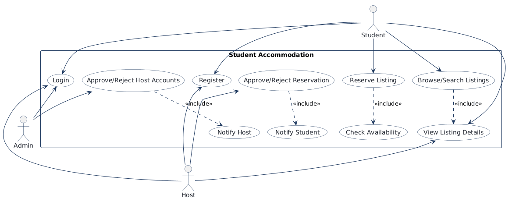
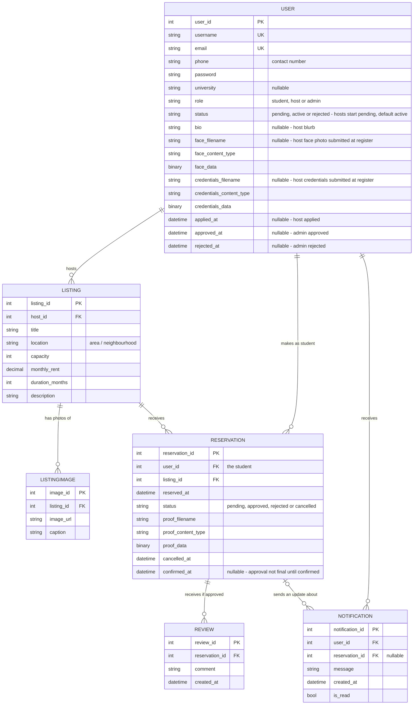
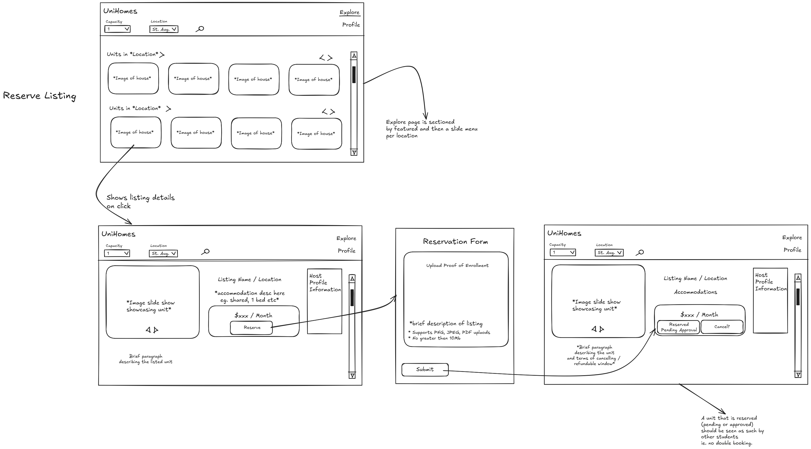
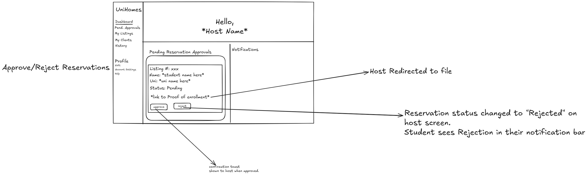
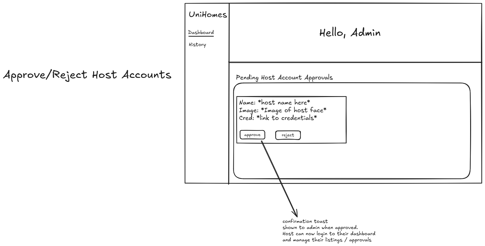

<!-- student-build:skill-integrity
status: pass
root: e84cd692d0b85eefe546385661958c27d07e8be6c5176a82012f68ccff5c8beb
expected_root: e84cd692d0b85eefe546385661958c27d07e8be6c5176a82012f68ccff5c8beb
mismatches: none
-->

# COMP 3613 Assignment 1

Draft this file with the Guide. **Update it after every phase milestone** before you pause. The use-case diagram is a UML PNG at `docs/diagrams/use-case.png`, linked from this file as `diagrams/use-case.png` (path relative to `docs/report.md`). The model diagram is Mermaid. **Embed wireframe images** as `wireframes/<file>` (files live in `docs/wireframes/`).

Do not put your student ID in this file if you will commit it. The PDF cover adds your name and ID at export time.

## Assigned project

**Student Accommodation** (brief 6). An Airbnb-like marketplace for finding nearby student accommodation: trusted listings, reviews, and tenant / booking management.

## Three workflows

### 1. Reserve Listing (Student)

### 2. Approve/Reject Reservation (Host)

### 3. Approve/Reject Host Accounts (Admin)

## Use case diagram

Phase 2 notes (student decisions):

- **Shared use cases:** *Login* is used by all three actors (one shared use case). *Register* is started by a Student or a Host (role chosen at registration). *View Listing Details* is shared — the Host may open a listing read-only, the Student views it as the place to reserve.
- **«include»:** *Reserve Listing* «includes» *Check Availability* (always part of reserving). *Approve/Reject Reservation* «includes» *Notify Student* (the host's decision always notifies the student). *Browse/Search Listings* «includes» *View Listing Details* (browsing leads into details). *Approve/Reject Host Accounts* «includes» *Notify Host* — assumed as the mirror of *Notify Student*.
- **Gaps closed this phase:** *Register* (role choice: student or host; a host registration enters the admin's approval queue — this feeds *Approve/Reject Host Accounts*). *Browse/Search Listings* added in front of *View Listing Details* so a Student can reach the listing they reserve.
- Assumed in one line: *Notify Host* mirrors *Notify Student*; a registering visitor is modelled as the Student/Host actor they become.

## Model diagram

First draft (Phase 3), **revised in Phase 4** (wireframe-derived fields added: `LISTING.location`, `USER.status`, `USER.bio`, `USER.face_*`, `USER.credentials_*`; see Phase 4 notes under Wireframes). **Revised in Phase 5** to match the implemented `USER` model exactly: `name` → `username`, `account_status` → `status`, `credential_*` → `credentials_*`, and the `face_*` byte triple plus `applied_at` / `approved_at` / `rejected_at` added. `USER.phone` is drawn in the ERD and the student is adding it to the model next. Update this section again whenever polish revises the model, and note what changed.

Phase 3 notes (student decisions):

- **Ownership:** `Listing` holds `host_id` back to `User` — one host owns many listings, a listing has exactly one host. This is what lets *Approve/Reject Reservation (Host)* find the reservations that belong to that host's listings. A listing has zero to many `ListingImage` rows (`ListingImage.listing_id` → `Listing`).
- **Notifications:** a notification always belongs to a `User` (`Notification.user_id`) and *may* also point at the reservation it is about (`Reservation.reservation_id`, nullable) — e.g. "your reservation was approved". A reservation therefore has zero or many notifications, and the link is optional on both readings.
- **Availability rule (not date-based):** a listing's `capacity` is the number of active reservations it holds. A reservation occupies one slot while `pending` or `approved`; the slot is freed when the student cancels or the host rejects. The listing reads as reserved/full when active reservations reach `capacity`. `duration_months` is the length of each approved stay.
- **Uniqueness:** a student may hold only one reservation per listing — unique on `(user_id, listing_id)`. Assumed: after a rejection or cancellation they may try again for that same listing.
- **Reviews:** only an `approved` reservation may produce reviews, and one reservation may produce more than one review (`Reservation ||--o{ Review`).
- **Cancellation:** the student may cancel at any time while the reservation is `pending` or `approved`, **until they accept it**. Accepting sets `confirmed_at` and locks the reservation — after that it can no longer be cancelled from the UI (and the service refuses it server-side too).
- **Approval confirmation:** after the host approves, the student is notified and accepts from the listing details page, which sets `confirmed_at`. Modelled as nullable `confirmed_at` on `RESERVATION` rather than a separate status. *Scope decision in Phase 5:* the 24-hour auto-cancel that was sketched here **was not implemented** — the student chose to ship the accept action only, so an unconfirmed approval stays `approved` indefinitely rather than expiring.
- One line of assumptions: `confirmed_at` (above), re-reserving after cancel/reject, and `duration_months` as stay length. Everything else came from the student's answers.

## Wireframes

Student-crafted images live in `docs/wireframes/`. Embedded here with paths relative to this file.

### Reserve Listing (Student) — `workflow1.png`

### Approve/Reject Reservation (Host) — `workflow2.png`

### Approve/Reject Host Accounts (Admin) — `workflow3.png`

`python manage.py report` also embeds any PNG/JPG still missing from `docs/wireframes/`.

### Coverage blocks

<!-- student-build:wireframe-coverage
use_case: Login
image: starter FastStarter login screen (student decision: reuse + retheme, no wireframe)
covered: yes
-->
<!-- student-build:wireframe-coverage
use_case: Register
image: starter FastStarter register screen (student decision: reuse + retheme, plus a host credentials upload field)
covered: yes
-->
<!-- student-build:wireframe-coverage
use_case: Browse/Search Listings
image: docs/wireframes/workflow1.png
covered: yes
-->
<!-- student-build:wireframe-coverage
use_case: View Listing Details
image: docs/wireframes/workflow1.png
covered: yes
-->
<!-- student-build:wireframe-coverage
use_case: Reserve Listing
image: docs/wireframes/workflow1.png
covered: yes
-->
<!-- student-build:wireframe-coverage
use_case: Check Availability
image: docs/wireframes/workflow1.png
covered: yes
-->
<!-- student-build:wireframe-coverage
use_case: Approve/Reject Reservation
image: docs/wireframes/workflow2.png
covered: yes
-->
<!-- student-build:wireframe-coverage
use_case: Notify Student
image: docs/wireframes/workflow2.png
covered: yes
-->
<!-- student-build:wireframe-coverage
use_case: Approve/Reject Host Accounts
image: docs/wireframes/workflow3.png
covered: yes
-->
<!-- student-build:wireframe-coverage
use_case: Notify Host
image: docs/wireframes/workflow3.png
covered: yes
-->

### Phase 4 notes (student decisions)

- **Model revisions applied** (metadata the images already show): `LISTING.location` — *workflow1* (Location filter "St. Aug.", "Units in \*Location\*" sections, "Listing Name / Location"); `USER.account_status` — *workflow3* ("Pending Host Account Approvals" queue; host can only log in after approval); `USER.bio` — *workflow1* (Host Profile Information panel); `USER.credential_filename / credential_content_type / credential_data` — *workflow3* ("Cred: \*link to credentials\*").
- **Declined by student:** `USER.profile_image` and `LISTING.is_featured`. Assumed: the explore "featured" note becomes plain per-location sections, and the host panel shows name + bio only.
- **Login / Register** are covered by the FastStarter screens, to be rethemed in Phase 5. The **register form gains a credentials file upload** for host-role registrations (assumed: same rules as the reservation proof — PNG/JPEG/PDF, max 10 MB).
- **Student confirmation path (Phase 3 rule made concrete):** the approval notification links to a reservation view where the student clicks **accept** or **cancel**, which sets `confirmed_at`. Implemented in Phase 5 on the listing details page — no redraw needed.
- **Rejected host:** blocked from login, but the same account may re-upload credentials and re-enter the admin queue (`account_status` returns to pending).
- No new entities: the *My Clients*, *History*, and *Notifications* panels on the dashboards are views over existing rows.

## Theming

Branding preferences (Phase 5, student's words):

- **Colors:** orange, black, white → tokens `--brand-accent: #e2620f`, `--brand-accent-2: #a83d00`, `--brand-sidebar: #16130f`, `--brand-ink: #17130f`, `--brand-bg: #ffffff`, `--brand-surface: #faf7f2`.
- **Typeface:** professional → **Inter** (`--brand-font-display` / `--brand-font-body`), weights 400–800.
- **Tone:** warm, welcoming, professional — copy on landing ("Student accommodation, made simple" / "Welcome home.") and auth ("Welcome back…", "Join UniHomes…").
- **Logo or wordmark:** **UniHomes** (text wordmark in nav, hero, auth panels, sidebar).

Applied in code: `app/static/css/app.css` tokens; landing (`/`), `login.html`, `register.html` restyled with orange/black/white gradients and UniHomes wordmark; `authenticated-base.html` sidebar uses brand tokens; `401.html` gradient retinted. Starter demo copy removed from landing; `/config` kept.

## Implementation notes

One named workflow at a time. Include verify notes and polish / model revisions (Phase 5). Do not treat the first build as final.

### Workflow 1 — Reserve Listing (Student): Browse/Search Listings

- **Choice:** explore filters are query parameters on one `/explore` route (student Choice A).
- **Model revision (student):** `USER` primary key renamed `id` → `user_id` so the code matches the ERD (`USER.user_id PK`). Starter ripple updated: JWT `sub`, `UserResponse`, seed/CLI reads. `LISTING.host_id` and `RESERVATION.user_id` FKs now resolve to `user.user_id`.
- **Code checks:** SQLModel snippet (`app/models/listing.py` — Listing fields; first FK attempt pointed at a non-existent `host.host_id`, corrected after two reviews); repository snippet (`app/repositories/listing.py` — `search()` with optional filters, SQL only in the repository); thin route (`app/routers/explore.py` — binds query params, constructs Repository + Service, calls `service.cards()` / `known_locations()`, no `select`/`db.exec` in the router).
- **Glue added by Guide:** `ListingImage`, `Reservation` models; `ListingService.cards()` grouping + `ListingRepository.images_for()`; `explore.html` template (filter bar, per-location sections, themed cards); seed now includes `host / hostpass` and 4 demo listings.
- **Verify 1 (student):** `/explore` renders 4 seeded listings in per-location sections, Location filter lists both locations, capacity filter narrows. Three fixes from that pass: missing `user` in the route context (500 — student fixed), capacity dropdown capped to 4 (student request), rent shown to 2 decimal places (student request). Guide also retinted `.btn-primary` to the brand orange (was Bootstrap blue).
- Model unchanged this pass; `ListingCard.monthly_rent` now formats `:.2f` in the service layer.

### Workflow 1 — Reserve Listing (Student): details + reserve (verified)

- Student verified the full flow: explore → details → Reserve → proof upload → "Reserved — Pending Approval" → Cancel frees the slot. Refused paths confirmed: non-PNG/JPEG/PDF proof, >10 MB proof, duplicate active reservation.
- **Student bug fixes (their snippets):** FastAPI `HTTPException` import in the details route; "currently reserved" now decided in the **service** (`details()` filters to active statuses, so a cancelled booking shows Reserve again — Phase 3 re-reserve rule); unique index text aligned to stored enum names (option B). Guide fixed a missing trailing comma in `__table_args__` that broke table mapping (Guide miss in review).
- **Guide glue:** `reservations.py` routes (form GET, submit POST with file-type/size checks, cancel POST) + `reservation_form.html`; `ListingService.details()`; `listing_details.html` (slideshow, rent 2dp, Reserve / Reserved-Pending-Cancel / Fully booked states, Host Profile panel).
- **Polish pass 1 (student steering):** student home (`/app`) was an empty starter shell — now redirects to Explore, the wireframe's front door for a signed-in student.
- **Polish pass 2 (student steering):** smooth in-app navigation via htmx `hx-boost` (Option A, student's pick) — Explore ↔ details ↔ reserve no longer full-page reloads; each location section on Explore is a card slider (Bootstrap carousel, `< >` arrows when >4 listings); details slideshow now has real slides (3 seeded placeholder photos per listing in `app/static/img/listing-*.svg`). Student caught two htmx defects and fixed via Guide: (1) boosted responses were full HTML documents swapped into `<body>` — unstyled page after login — `base.html` now renders a title+content partial when `HX-Request` is present; (2) shell styles lived only in the authenticated page's inline `<head>` block, missing after boosted swaps — moved into `app.css`. Student request: Home tab dropped from the sidebar (Explore + Logout only). Note: a boosted 404 returns FastAPI's JSON detail; acceptable for now, revisit if it confuses users.
- **Polish pass 2 verified by student:** login lands on a styled Explore; crossfade navigation Explore ↔ details ↔ reserve; browser Back works; sliders and photo arrows intact after the CSS move. **Workflow 1 complete.**

### Workflow 2 — Approve/Reject Reservation (Host)

- **Design decisions (student, via question chips):** rejections surface through a real **Notification table + navbar bell** (not flashes); the host sidebar gains **only** "Pending Approvals" (the other four wireframe entries — Dashboard, My Listings, My Clients, History — would have been dead links, so they stay unbuilt). Also student choice: add a **`university`** field to `USER` so the workflow2 card can show "Uni:" as drawn.
- **Student snippets (2):** `app/models/notification.py` — `Notification` SQLModel (`user_id` FK to `user.user_id`, optional `reservation_id`, `message`, `created_at`, `is_read`), matching `reservation.py`'s import style; and the **approve + reject thin routes** in `app/routers/reservations.py` (load → 404 → `service.approve()/reject()` in `try/except ValueError` → flash → 303 back to `host_approvals_view`, no SQL in the router).
- **Guide review of student snippets — 3 defects found and fixed by student:** reject route was missing entirely; approve/reject redirected to the *student's* listing page instead of the host's approvals screen; `Notification` wasn't registered in `app/models/__init__.py` (table would never be created). Student also left a stray `listing_id` kwarg on the `host_approvals_view` redirects — removed by Guide.
- **Guide glue:** `ReservationRepository.for_host()` (joins Listing + User, returns `(reservation, listing, student)` triples — no N+1 in templates); `NotificationRepository` (`for_user`, `unread_count`, `mark_read`, `mark_all_read`); `ReservationService.approve()/reject()` with `_require_host_action` — **only the listing's host may act, and only on PENDING** (mirrors `cancel()`'s ownership rule) — plus `_notify()` writing the student-facing row, and `reserve()` now notifies the host of new requests; `GET /host/approvals`, `GET /reservations/{id}/proof` (inline file serving, restricted to the uploading student or the listing's host), `/notifications/bell` + `/notifications/read-all`; `host_approvals.html` (Hello + Pending cards with Listing #, Name, Uni, status, proof link, approve/reject; Notifications panel) and `notifications_bell.html` fragment; `HostDep` gate; bell mounted in the navbar via `hx-get` on load; "Pending Approvals" sidebar item rendered only for `role == "host"`; `university` ripple (model, register form + service, seed values); seed now creates one pending reservation (bob → listing 1) so the host screen is non-empty on first run.
- **Guide verification (TestClient, 16 checks pass):** full loads still return complete documents and `HX-Request` returns fragments; approve flips to Approved and redirects to `/host/approvals`; re-approve rejected ("not pending"); reject empties the list and the slot frees (student can re-reserve); bob's bell shows the approval/rejection and "Mark all as read" clears the badge; **authorization enforced in the service** — bob's approve/reject attempts leave status `pending`, admin gets no proof file, student/admin never see the host screen; sidebar item host-only; proof link carries `hx-boost="false"` so the file opens as a real navigation.
- **Schema change:** `user.university` column → requires `python manage.py init` (drops + reseeds) before running.
- **Verified by student:** approval and rejection both appear in the student's notification bell; the slot frees after rejection and the student can re-reserve. **Workflow 2 complete.**
- **Student-reported defect (polish pass 3):** hosts landing on Explore could still open the Reserve button — role rule missing. Fixed at three layers: `ListingDetails.can_reserve` (service, `viewer.role != "host"`), the details template shows a "Viewing only — hosts don't reserve" badge instead of the button, the form GET 303s hosts back to details, and `ReservationService.reserve()` raises for hosts so a direct POST creates no row. Guide also fixed a same-pass htmx bug: the navbar bell's `hx-get` inherited `hx-target="#page"` from `<body>` and wiped the whole page on load — scoped with `hx-target="this"`. Verified (11 checks): host sees details only and cannot reserve by URL or POST; student and admin flows unchanged.

### Workflow 3 — Approve/Reject Host Accounts (Admin)

- **Design decisions (student, via question chips):** sign up as host → **pending, cannot log in until approved**; **extend the `USER` model** (face image, credentials, status, decision timestamps) rather than a second table; admin sidebar = **Dashboard + History** (History is read-only past decisions).
- **Student snippets (2):** `app/models/user.py` — `HOST_ACCOUNT_STATUS` enum (`PENDING`/`ACTIVE`/`REJECTED`), face-image and credentials byte triples mirroring workflow 2's proof pattern, `status` + `applied_at`/`approved_at`/`rejected_at`; and the **approve + reject thin routes** in `app/routers/admin_home.py` (load applicant → 404 → `service.approve_host()/reject_host()` in `try/except ValueError` → flash → 303 back to `admin_home_view`, no SQL).
- **Student design choice (defended):** `status` defaults to **`ACTIVE`** so already-seeded users (bob, admin, host) are never locked out by default; **registration is the only place `PENDING` is assigned**. Enum renamed `APPROVED → ACTIVE` for card readability. Also fixed on review: `face_img: str` → filename/content-type/data triple (a string can't hold a PNG), `applied_at` default removed, `get_by_id`/`username` name fixes in the routes.
- **Guide glue:** `UserService.approve_host()/reject_host()` with `_require_admin_decision` (admin role + **PENDING-only**), approve writes a welcome Notification the new host sees in the bell; `UserRepository.save()/pending_hosts()/decided_hosts()` (enum-name-safe queries); **login gate** in `login.py` — pending hosts see "awaiting admin approval", rejected hosts see the rejection message, no cookie issued either way; `is_host` hardened to require `ACTIVE` as defence-in-depth; `register.py` gains a **role radio + face/credentials uploads** (PNG/JPEG + PDF, ≤10 MB each, role forced server-side) and `AuthService.register_user()` sets `PENDING` + `applied_at` for host signups; rebuilt `admin.html` (Name/Face-image/Cred-link cards + approve/reject per workflow3.png), `admin_history.html`, admin sidebar (Dashboard + History); `GET /admin/applicants/{id}/face` + `/credentials` serving routes (AdminDep only); seed adds **cara** — a pending host applicant with face + credentials files.
- **Guide verification (TestClient, 32 checks pass):** seeded users all still log in (ACTIVE default intact); fresh host signup lands `PENDING` and is refused at login with the awaiting-approval flash; student signup unaffected; dashboard lists only applicants (not bob); approve → toast, card disappears, host can log in, bell shows welcome; double-approve and reject-then-approve flash the service's reason (no silent success); reject → toast + rejection flash at login; History shows both decisions and hides undecided users; student blocked from `/admin` and the file-serving routes; approving a student account is refused.
- **Schema change:** `user` gains face/credentials/status/timestamp columns → run `python manage.py init` (drops + reseeds) before running.
- **Verified by student in browser:** host signup blocked at login with the awaiting-approval flash; admin approves with toast, face image + credentials link open on the card; approved host logs in and sees the welcome bell message; cara rejected → rejection flash at login; History shows both decisions; double-decide flashes the reason. **Workflow 3 complete.** Student also verified the workflow 2 polish fix (host sees "Viewing only" badge, reserve URL bounces, no reserve as host).

### Phase 5 polish — model/ERD sync (student-driven)

- **Model diagram corrected to match the implemented models.** The `erDiagram` in *Model diagram* above was diffed field-by-field against all seven SQLModel classes; only `USER` was out of sync. Fixes: `name` → `username`; `account_status` → `status` (the code already renamed the enum value `APPROVED → ACTIVE`, so the note now reads "pending, active or rejected … default active"); `credential_filename/content_type/data` → `credentials_*` (plural, matching `app/models/user.py`); and the missing fields added — the `face_filename / face_content_type / face_data` triple and `applied_at / approved_at / rejected_at`. `LISTING`, `LISTINGIMAGE`, `RESERVATION`, `NOTIFICATION` and `REVIEW` already matched and were left untouched.
- **`USER.phone` ripple applied** (student added `phone: Optional[str] = None` to `app/models/user.py`; Guide wired the rest). The create schemas (`AdminCreate`/`RegularUserCreate`/`HostCreate`) inherit `UserBase`, so `phone` flows into every payload unchanged. Changed: `POST /register` binds an optional `phone: str | None = Form(None)` and forwards it positionally; `AuthService.register_user()` takes `phone` before `university` and passes it to both `HostCreate` and `RegularUserCreate`; `register.html` gains an optional `type="tel"` input; the seed gives bob/admin/host/cara phone numbers (demo tuple unpacking extended to six elements); and `phone` is now shown on the host's reservation card, the admin dashboard card, and as a new column in admin History. It stays optional everywhere — a signup with no phone stores `None` and renders "Not provided"/"—". Verified with a 17-check TestClient sweep (seed phones, student/host/no-phone signups, host still PENDING, admin approve → History row with aligned 6 columns, host card phone, and explore/details/reserve regression). Note: a successful `POST /register` returns **303** to login, not the decorator's declared 201 — pre-existing behavior, unchanged here.
- **`REVIEW`** (student-implemented, `app/models/review.py`) matches the ERD — `review_id PK`, `reservation_id FK` → `reservation.reservation_id`, nullable `comment`, `created_at`. Its `RESERVATION ||--o{ REVIEW : "receives if approved"` relationship is in place. **Wired in Phase 5** as a read-only seeded feature — see *Phase 5 — reviews (seeded, read-only)* below.

### Phase 5 polish — notification bell redesign (student-driven)

- **Panel replaces the Bootstrap dropdown** (student: "the notification bell looks ugly"). Deliberately *not* `data-bs-toggle="dropdown"`: "Mark all as read" swaps `#notifBell` via `outerHTML`, and that swap destroys an open Bootstrap dropdown mid-interaction. The bell is now one self-contained htmx fragment (`app/templates/notifications_bell.html`) holding the button, a click-away `.notif-backdrop`, and the `.notif-panel` (header + count + close, scrollable list, footer action). A single route serves every state — `GET /notifications/bell` takes `?open=1` to open and the bare URL to close, so the button's own `hx-get` is the toggle. The now-unreferenced `GET /notifications/toggle` route was deleted.
- **"Cleared after read" implemented** at the view layer, not by deleting rows: the fragment keys each item off `unread_ids` (`NotificationRepository.unread_ids()`), so a read notification stays in the list and drops its `is-unread` class, `mail` icon and orange dot in favour of `mark_email_read`. `notifications_bell_view` passes `total` for the header count and `open` as an explicit `Query` param.
- **Guide bug found and fixed in the same pass:** `POST /notifications/read-all` re-rendered the *closed* bell, so pressing the button collapsed the panel the student was looking at (htmx swaps the fragment in place — the panel vanished under the cursor while its badge cleared correctly). Fixed by routing `keep_open` through to the bell view, with the template posting `?keep_open=1`. Also fixed: `total` was referenced by the template but never put in the context, so the header count rendered blank; and `url_for('notifications_bell_view', open=1)` raised `NoMatchFound` because Starlette treats extra kwargs as path params — the query string is now concatenated literally.
- **New panel CSS** in `app.css` (`.notif`, `.notif-panel`, `.notif-head`/`-count`/`-icon`/`-title`, `.notif-close`, `.notif-list`, `.notif-item`/`-icon`/`-body`/`-msg`/`-time`, `.notif-dot`, `.notif-empty`, `.notif-foot`, `.notif-clear`, `.notif-backdrop`) built on the existing brand tokens — warm surface, orange accent, Inter — matching the rounded, warm notification panel the student referenced. Cache-buster `?v=20261012k`.
- **Guide verification (TestClient, 49 checks pass):** closed bell shows badge 1 and no panel; open panel shows both seeded notifications with only the unread one styled/iconed/dotted, formatted timestamps, and a header count of 2; mark-all keeps the panel open, clears the badge and unread styling, swaps both icons to `mark_email_read`, retains both messages and removes the button; reopening shows both read with no badge; a third notification re-arms the badge to 1; bell click toggles open/closed; every template-referenced CSS class exists.
- **Guide bug found and fixed on student review ("the X doesn't do anything and I can't navigate away"):** the backdrop and close button only carried a `data-notif-close` marker with **no listener behind it**, while `.notif-backdrop` is `position: fixed; inset: 0` at `z-index: 1040` — so it blocked every click on the page and nothing could dismiss it. Both now issue `hx-get` to the bare bell URL with `hx-target="#notifBell" hx-swap="outerHTML"`, i.e. they swap the fragment back to its own closed state (the same route the bell's own toggle uses, so open and close share one code path). `.notif-panel` stays at `z-index: 1050` so clicks inside the panel never fall through to the backdrop. No CSS changed, so the cache-buster remains `?v=20261012k`.

### Phase 5 polish — reservation status badge driven by the real status

- **Student report:** "when student is approved by host, details page should switch to Reserved — Approved. It is still saying pending approval." The badge in `listing_details.html` was **hardcoded** to `Reserved — Pending Approval` with `text-bg-warning` — it never read `details.viewer_reservation.status`, so the label froze at PENDING forever even though `ReservationService.approve()` was correctly flipping the row to `APPROVED` and writing the approval Notification. The DB and the service were right; only the view lied.
- **Fix lives in the service layer, not the template** (no branching logic pushed into Jinja): `ListingDetails` gains two derived properties — `reservation_label` and `reservation_tone`. `reservation_label` returns `Reserved — Pending Approval` for PENDING, `Reserved — Approved` once the row is APPROVED, and `Reserved — Confirmed` once `confirmed_at` is also set (the accept rule, wired to a real route in the next section). `reservation_tone` maps those to `text-bg-warning` / `text-bg-success`. The template now renders `{{ details.reservation_tone }}` / `{{ details.reservation_label }}` and the stale "Reserved Pending Approval" comment was rewritten to describe the real state machine.
- **Guide verification (TestClient, 16 checks pass, end-to-end through the real routes):** bob reserves → badge reads *Reserved — Pending Approval* on a warning tone with Cancel still offered; the host approves via `POST /reservations/{id}/approve` → the row reads `APPROVED` in the DB and the details badge flips to *Reserved — Approved* on a success tone with **no** "Pending" text anywhere on the page; the approved row leaves the host's approvals queue; bob gets the approval notification in the bell; cancelling frees the badge and returns the Reserve button (re-reserve rule intact).
- **Adjacent states checked so nothing else regressed:** a rejected reservation shows **no** reserved badge and returns the Reserve button; a host viewer still sees *Viewing only — hosts don't reserve*; a host is still redirected off the reserve form (303); the notification-bell suite stays **49/49**. No CSS changed, so the cache-buster remains `?v=20261012k`.

### Phase 5 — student accept action (approval made final)

- **Two design questions put to the student before coding** (both changed the implementation): (1) *can a confirmed reservation still be cancelled?* → **no, accepting locks it in**; (2) *wire the Phase 3 24-hour auto-cancel now?* → **no, accept action only**. The 24-hour expiry stays an unimplemented Phase 3 sketch, and the report's Phase 3 business-rule notes were rewritten so they no longer claim it.
- **`ReservationService.confirm()`** (new): owner-only, `APPROVED`-only, and refuses a second accept. Sets `confirmed_at` and leaves `status` as `APPROVED` — matching the ERD's "approval not final until confirmed", where `confirmed_at` rather than a new enum value is what makes it final. Notifies the host that the student accepted.
- **`ReservationService.cancel()` hardened:** it previously permitted cancelling anything in `ACTIVE_STATUSES`, so an accepted reservation could still be freed by a direct `POST`. It now refuses when `confirmed_at` is set — the lock is enforced in the service, not merely by hiding the button.
- **New thin route** `POST /reservations/{reservation_id}/confirm` (`reservation_confirm_view`), mirroring the existing approve/reject/cancel routes: 404 on a missing row, `ValueError` flashed on a rule violation, redirect back to the listing details on success.
- **Two view flags on `ListingDetails`** so the template stays dumb: `can_accept_reservation` (APPROVED and still unconfirmed) drives the **Accept** button, and `can_cancel_reservation` (`confirmed_at` is `None`) drives **Cancel**. The badge round-trips `Pending Approval` → `Approved` → `Confirmed` with no template branching.
- **Copy corrected to match the shipped rules:** the details footnote no longer promises "accept or cancel … within 24 hours" (now: accepting locks the reservation in), and the approval Notification body drops "Confirm within 24 hours" for "Accept it from the listing page to lock it in."
- **Guide verification (TestClient, 19 + 5 checks pass, end-to-end through real routes):** pending shows Cancel but no Accept; after host approve the badge reads *Reserved — Approved* with Accept (primary-styled) and Cancel both present; `POST /confirm` returns 303, the row stays `APPROVED` with `confirmed_at` set, and the badge flips to *Reserved — Confirmed* with **both** actions gone and no stray "Pending" text; a direct `POST /cancel` on the confirmed row is refused server-side and leaves the row untouched; the host gets the acceptance notification; a double-accept is a flashed error, not a 500. Adjacent paths: a **rejected** reservation offers neither action and returns Reserve; **pending cancel** still works; **approved-but-unconfirmed cancel still works** (per the student's choice); a **host viewing the same confirmed listing** sees neither action, only the *Viewing only* badge, while the student still sees *Confirmed*; the service rejects a non-owner confirm ("not the owner") and a non-approved confirm ("not approved"). The notification-bell suite remains **49/49**. No CSS changed, so the cache-buster remains `?v=20261012k`.

### Phase 5 — reviews (seeded, read-only)

- **Scope set by the student:** reviews are **seeded only** — the demo does not need a "write a review" screen. So there is no authoring route, no form and no service write path for reviews; the work was registering the model, a read repository, and a place to show them.
- **`Review` was never registered in `app/models/__init__.py`**, so `SQLModel.metadata.create_all` would never have created the table — the same defect found earlier with `Notification`. Added to the imports and `__all__`; the `review` table now exists after `python manage.py init`.
- **`ReviewRepository.for_listing()`** (new, `app/repositories/review.py`): joins `Review → Reservation → User` and returns `(review, student)` pairs newest-first, so the page can name the reviewer without N+1 lookups. **The Phase 3 rule is enforced on read as well as write** — the query filters to `Reservation.status == APPROVED`, so a review hanging off a pending, rejected or cancelled reservation is never shown. `create()` exists for symmetry but is not called by any route.
- **`ListingService` takes an optional third dependency**, `review_repo`, and `details()` maps rows into a new `ReviewCard` view shape (`comment`, `author`, `created_at`). `ListingDetails` gains `reviews` (defaulted, so existing constructions don't break) and a `review_count` property. Only `GET /listings/{id}` passes the repo — the reserve form builds the same service without reviews it doesn't render. No `select`/`db.exec` in any router.
- **Display: a third tab, "Reviews", on the details page** — reusing the tab pattern the student chose for Listing details | Host information, with a count pill in the label. Each review renders an initial avatar, the reviewer's username, a formatted date and the comment (`white-space: pre-line`, `overflow-wrap: anywhere` so seeded text can't break the layout). Listings with no reviews get an empty state that names the rule: *"Reviews come from students whose reservation the host approved."* New `app.css` block (`.review-list`, `.review`, `.review-head`, `-avatar`, `-meta`, `-author`, `-date`, `-body`, `-count`, `-empty`) built on the existing brand tokens; cache-buster bumped to `?v=20261012l`.
- **Seed (`app/cli.py`):** a second student, **dana** (`dana`/`danapass`), added to the demo users so **bob's live path stays pristine** — he can still walk listing 1 from pending → approved → accepted, and reserve fresh on 2, 3 and 4. Dana holds **approved + accepted** reservations (the only kind a review may hang off) on the *Shared Flat* and *Garden Cottage* listings, carrying **4 reviews across 2 listings** — deliberately several reviews on one reservation, matching `RESERVATION ||--o{ REVIEW`. **Listing capacities were respected so nothing reads as full for the demo:** listing 1 (cap 1) stays bob's live pending reservation, listing 2 (cap 2) has dana's 1 of 2, listing 3 (cap 1) is untouched, listing 4 (cap 3) has dana's 1 of 3.
- **Guide bugs caught while writing the seed:** `ReservationStatus` was never imported into `cmd_seed`; `datetime` is imported at line 244, *after* the block that used it (aliased to `_dt` and imported locally); and the proof PNG was scoped inside bob's `if`, so a re-seed without a drop would have raised `NameError` — Dana's copy is now defined inside her own block. The slug→title→listing lookup was also collapsed from a two-dict round trip to one mapping.
- **Guide verification (TestClient, 35 checks pass):** the details page has 3 tabs with a count pill of 2 on listing 2; both comments render with author *dana*, the avatar initial "D" and a formatted date; listing 4 shows 2 reviews, listing 3 shows the empty state **and** its rule explanation; **no write-review form exists anywhere**; the host sees the same reviews read-only with no Accept/Cancel; dana logs in. Capacities verified through the service: listing 2 is 1/2, listing 3 is 0/1, listing 4 is 1/3 — none full, and `can_reserve` is true with no viewer reservation for bob on any of them. Bob's listing 1 still shows the *Pending Approval* badge with a Cancel **path** and no Accept path, and after cancelling, Reserve returns. No `select`/`db.exec` in any router; all ten `.review*` classes exist in `app.css`; the bell suite stays **49/49**.

### Phase 5 polish — cara's applicant photo

- **Student report:** "add a profile pic for cara so that an image can be seen on the admin dash when approving her." The `admin.html` card was already correct — a 96×96 `` with `object-fit: cover` pointing at `/admin/applicants/{id}/face`. The real fault was in the **seed**: cara's `face_data` was a **1×1 pixel PNG** (22 bytes), so the route served a technically-valid image that rendered as a dot.
- **Fix:** a real 480×480 portrait JPEG downloaded to `app/static/img/faces/cara.jpg` (Unsplash License, face-centred crop) — the same local-file approach as the listing photos, so it works offline and on Render with no runtime hotlinking. `cmd_seed` reads the file at seed time and stores it in the `face_data` blob, with `face_filename`/`face_content_type` switched to `cara.jpg` / `image/jpeg`. A **fallback** keeps the old 1×1 PNG if the asset is ever missing, and `face_is_jpeg` drives the filename and content-type together so they can't disagree — the seed degrades rather than crashing on a fresh checkout. The seed still stores the file in the DB blob (not served from `/static`), preserving the existing admin-only access control on the serving route.
- **Guide assertion bug (not an app bug):** the first access-control sweep reported that students, hosts and anonymous visitors could all read the face and credentials routes at HTTP 200. They cannot — the **starter's 401 handler returns HTTP 200 with `401.html` ("Session Expired")**, so the sweep was judging on status codes. Re-run judging on the body, all pass.
- **Guide verification (TestClient, 15 + 15 checks pass):** cara's row now carries `cara.jpg` / `image/jpeg` / 30,747 bytes; the admin dashboard renders the `` tag with the 96px `object-fit: cover` styling instead of the `person` placeholder; the face route returns 200 as `image/jpeg` with real JPEG magic bytes, **480×480**, and an inline `Content-Disposition`. Credentials still serve as `application/pdf` alongside. **Access control confirmed by body, not status:** anonymous, a student (bob) and a host all receive the Session Expired page with no JPEG, no PDF and no applicant data leaked, for both the face and credentials routes and the `/admin` dashboard itself; only admin receives the real bytes. Cara remains **blocked from login while pending**, approve still transitions her to `ACTIVE`, and the face blob survives the approve. bob and host still log in; the bell suite stays **49/49**. No CSS changed, so the cache-buster remains `?v=20261012l`.

## Deployed app

Phase 6. Public Render URL (not localhost). Markers open this to mark the three workflows.

https://comp3613a1-7k3g.onrender.com/

Phase 6 notes:

- Deployed **manually** per `README.md` / `render.yaml` (Render MCP OAuth was unavailable for OpenCode, so the student created the resources in the Render Dashboard): Postgres `faststarter-db` (Oregon) + web service `faststarter` (Python, free, `main`), env vars `DATABASE_URI`, `ENV=production`, `PYTHON_VERSION`, `SECRET_KEY`, start command `python manage.py init --no-drop && python manage.py run --host 0.0.0.0 --port $PORT`, health check `/health`.
- Health check verified live: `GET /health` → `200 {"ok":true}`; the themed UniHomes landing page serves from the public URL.
- Demo data (bob / admin / host / dana / cara, 4 listings, demo reservations and reviews) is created by `init`/`seed` on first boot. If the Render database was created without running it, run `python manage.py seed` from the service **Shell** tab — the seed is idempotent and skips rows that already exist.
- Free-tier note: the web service sleeps after inactivity (~30–60s first wake); free Postgres expires after 30 days.

## Logins

Every account a marker needs, including extra users you added. Starter accounts:

- bob / bobpass — regular user
- admin / adminpass — admin
- host / hostpass — approved host (4 demo listings, 1 pending reservation from bob)
- cara / carapass — **pending** host applicant (for workflow 3; approve her as admin)
- dana / danapass — second student (approved + accepted reservations carrying the seeded reviews)

## YouTube URL

https://www.youtube.com/watch?v=7G7Jp71iF-g

## Session transcripts

Filled when the Guide builds the report: the agent writes chat markdown into `docs/transcripts/`; `python manage.py report` packages them.

Guide packaged **9** chat(s) in `docs/transcripts/` (and `docs/transcripts.zip`).

Index: [docs/transcripts/INDEX.md](transcripts/INDEX.md)

- [`phase-1-workflows`](transcripts/phase-1-workflows.md)
- [`phase-2-use-case`](transcripts/phase-2-use-case.md)
- [`phase-3-model`](transcripts/phase-3-model.md)
- [`phase-4-wireframes`](transcripts/phase-4-wireframes.md)
- [`phase-5-theme-build-polish`](transcripts/phase-5-theme-build-polish.md)
- [`phase-6-deploy-continued`](transcripts/phase-6-deploy-continued.md)
- [`phase-6-deploy`](transcripts/phase-6-deploy.md)
- [`pre-phase-1-setup`](transcripts/pre-phase-1-setup.md)
- [`report-export`](transcripts/report-export.md)

## Competency (student-judge)

Filled by Guide from the student-judge run when this report was built.

**Judged at:** 2026-10-12T23:51 (local) / 2026-10-13T03:51 UTC
**Evidence pass:** re-read native OpenCode Guide chats (9 sessions pulled to `docs/transcripts/*.md`) + current `docs/report.md` (prior judge.md ignored — no previous scorecard existed)

# student-judge competency report

**Student / session:** Will Wattley (816040298) — COMP 3613 Assignment 1, Student Accommodation (UniHomes)
**Artifact:** 9 native OpenCode Guide chats for this workspace (one per design phase, two for Phase 6, one report-export chat), exported to `docs/transcripts/*.md`; current `docs/report.md`; `docs/diagrams/use-case.png`; `docs/wireframes/workflow1-3.png`; live deployment at https://comp3613a1-7k3g.onrender.com/
**Phases in evidence:** 1–6 (COMP 3613; Phase 5 theme → build → polish; Phase 6 deploy — never generic 0–5)

### Totals
| | Count / value |
|--|--|
| Metrics on rubric | 12 (M1–M12) |
| N/A (excluded) | 0 |
| Metrics scored | 12 |
| Scoreable max | 48 |
| Awarded total | **46 / 48** |
| **Overall (avg of scored)** | **3.8 / 4** |
| Impression mark | **19 / 20** |

## Scorecard

| ID | Metric | Score / 4 | In avg | Evidence |
|----|--------|----------:|:------:|----------|
| M1 | Phase discipline | 4 | yes | One design phase per chat, self-enforced — a fresh chat per phase ("Using the student-build skill. Start phase 3." / "Start phase 4." / "Start phase 5."), the student declined to start Phase 6 in the build chat ("I will start phase 6 in another session"), and Phase 5 ran theme → 3 workflows → ~10 polish passes before deploy. |
| M2 | Problem framing | 4 | yes | Named project and all three workflows himself in the required format ("6" → `Reserve Listing (Student)` / `Approve/Reject Reservation (Host)` / `Approve/Reject Host Accounts (Admin)`), answered every include/extend and shared-use-case question ("The availability check is always part of reserving.", "one shared use case") and both gap-reconsider questions ("A registration is assumed where you have the option to register as a student or as a host.", "Their is a browse/search listing step in front of view listing details"), plus full entity/property list and theming preferences. |
| M3 | Decision ownership | 4 | yes | Owns the business rules in his words — capacity-based availability ("Each listing has a capacity. A listing is showed as reserved … if the capacity is full"), review gate ("only after they have been approved by the host"), uniqueness ("A student can only leave one reservation per listing"), cancel/confirm rule — plus bounded-choice picks ("you should apply all except User.profile_image and Listing.is_featured.", "B.", "1. shape B. 2. the check … should run on the service layer"), the ACTIVE-default defence ("Default status is now active so that the already seeded users won't be locked out"), and every scope call (seeded-only reviews, no 24-hour auto-cancel, sidebar trimmed to real links). |
| M4 | Artefact-before-code | 4 | yes | Built to the ERD and wireframes and hunted mismatches himself: "According to the ERD the user model has name and not username. Change ERD to fit. Also user has a phone I will add this in. … rename account status to simply status in ERD as it is so in the model" — a field-by-field ERD/code sync driven by the student, not a substitute design. |
| M5 | Verification habit | 4 | yes | Verified after every workflow with screenshots and observed-vs-wireframe notes: "4 listings as seeded. The filter shows the 2 locations present", "Workflow2 works as described. Approval and Rejection both show on the student's notifications bell", "1-6 works as described", "the confirmation workds as expected", "All workflows work. One final polish…"; also caught real defects ("details page should switch to Reserved - Approved / It is still saying pending approval") and retracted a false alarm honestly ("disregard last prompt. There was no error"). |
| M6 | Assignment fit | 4 | yes | Wireframe-first, ERD-faithful, FastStarter auth reused, Phase 5 polish completed before Phase 6. Architecture verified live in this pass: searching `app/routers/` for `select(...)`, `db.exec`, `session.query`, `ilike` or `or_` returns **nothing** — routes bind and call services; business rules sit in services; SQL only in repositories. |
| M7 | Slice explanation | 3 | yes | Three workflows each got his own SQLModel + thin-route snippets typed into real files (`listing.py`, `notification.py`, `user.py` + explore / approve-reject / admin approve-reject routes), all logged `architecture_ok: yes`, and he reasoned in his own words about layer and design ("the check for is this unit already full should run on the service layer", the ACTIVE default). Held at 3 rather than 4: own-words explanations are terse one-liners ("listing.py typed. Choice A.", "snippets 1 and 2 done. Review") and the model snippet needed two FK-target corrections (`passed: partial` → `passed: no`) before it matched the ERD. |
| M8 | Prompt quality | 3 | yes | Phase-tagged openers and concrete, screenshot-backed mismatch/polish notes ("when capcity is at \"Any\" and i search i get the following in the screenshot", "the x doesnt do anything"). Held at 3: many turns are minimal confirmations with no detail of their own ("B.", "1-4 verified and correct", "snippets 1 and 2 done. Review"). |
| M9 | Response to pushback | 4 | yes | Never accepted the first build — ~10 consecutive polish rounds with re-reports until it matched his eye: sidebar removed, nav/filter alignment ("It still looks the same" ×3 → "it is centered. Great."), card sizing (screenshot comparisons), notification bell redesign ("The notification bell looks ugly I want something like this"), details-page layout ("Okay revert to the layout before. I dont like this layout."), model/ERD revisions, cara's photo. |
| M10 | Integrity | 4 | yes | `python manage.py skills-verify` → "Skill integrity: pass … All protected skill files match `.agents/skills.lock.json`"; working tree clean. No `student-judge:sincerity` blocks, no paste dumps, no "just apply", no meta-laundering; all fixes were reported from his own runs/screenshots. |
| M11 | Provenance continuity | 4 | yes | Every built slice traces to his Phase 1–4 artefacts — the three named workflows, his six-entity ERD, and `workflow1-3.png` (e.g. workflow 3's card drove the face/credentials/status extension exactly as negotiated in Phase 4). No orphan or parallel product. |
| M12 | Sincerity trajectory | 4 | yes | No suspicion was raised at any point; consistent, honest engagement throughout, including volunteering a correction against himself ("disregard last prompt. There was no error"). |

## Strengths

- **Textbook phase discipline:** six phases, six chats, artefact written and report updated before each pause, and the student himself asked to move Phase 6 to a new session.
- **Genuine design ownership:** he supplied the project, the three `Feature (user)` workflows, all six entities with properties/statuses/nullability, and every business rule (capacity availability, one-reservation-per-listing, approved-only reviews, cancel-until-accept) in his own words.
- **Real Phase 2/3/4 engagement:** include/extend and shared-use-case answers, two missed-use-case reconsider answers (register-as-host, browse-before-details), relationship ownership (`Listing.host_id`), and a bounded choice on rejected-host re-entry.
- **Snippet floor met on all three workflows** — SQLModel + thin route per workflow, `architecture_ok: yes` on every logged check, and no SQL anywhere in `app/routers/` (checked directly this pass).
- **Verification with evidence, not assertions:** screenshots after each workflow, observed-vs-wireframe notes, refused-path checks, and defects reported from his own runs (500 on explore, stale badge, dead notification close button).
- **Sustained polish steering** — the clearest sign of ownership: a dozen UI refinement rounds, two model revisions (ERD sync, `phone` ripple), and scope decisions (seeded-only reviews, accept action instead of 24-hour auto-cancel).
- Phase 2 include/extend + shared-use-case + missed-use-case answers, Phase 3 relationship pushback, and Phase 4 workflow clarifications are all credit-earning and present.

## Gaps (priority order)

1. **Phase 6 gate — the deployed app has no seeded demo data, so marker logins fail (checked live, 2026-10-12/13).** `POST /login` for `bob/bobpass`, `admin/adminpass` and `host/hostpass` on https://comp3613a1-7k3g.onrender.com/ all redirect back to `/login` with *"Incorrect username or password"*, and `/health` returns `200 {"ok":true}` — i.e. the service is live and themed, but the database holds no users/listings. The student raised this himself during deploy ("ok i manually deployed but now the preseeded data is not present") and the chat ends with Guide asking for the logs — no confirmation it was resolved. **Fix (student runs it):** Render Dashboard → web service → **Shell** → `python manage.py seed` (idempotent), *or* make the Start Command exactly `python manage.py init --no-drop && python manage.py run --host 0.0.0.0 --port $PORT` and clear build cache & deploy. Then re-verify the four marker logins and re-export.
2. **Own-words layer explanations are terse** (keeps M7 at 3 rather than 4): most Phase 5 replies are status lines ("snippets 1 and 2 done. Review"). A sentence or two per snippet on *why* the rule belongs in the service/repository would lift it.

*Not counted as gaps (opportunity rules):* no starter-auth lecture, no explore report, no final all-workflow browser walkthrough ritual, no Cursor `.jsonl` (this was an OpenCode session — chats pulled to `docs/transcripts/*.md`), and code-check **log blocks** exist only for workflow 1 — but Guide did assign and review snippets for all three workflows, so this is a Guide logging omission, not a student refusal.

## Phase gate status

| Phase | Status | Note |
|-------|--------|------|
| 1 | met | Student picked brief 6 and named three `Feature (user)` workflows; report updated; 0/4 questions needed. |
| 2 | met | 5/5 steering questions answered (include/extend, shared Login/View Details, register gap, browse gap); UML PNG rendered and embedded; assumptions noted. |
| 3 | met | Student named all six entities + properties; relationship and edge-case answers owned by him; ERD fixed after his rendering feedback (fake entities, missing `ListingImage` edge). |
| 4 | met | All three named workflows have images with readable paths to "done"; coverage blocks written; four wireframe-derived model fields accepted, two declined with reasons; confirmation step, register upload and rejected-host re-entry clarified. |
| 5 | met | Theme applied (orange/black/white, Inter, UniHomes) before building; all three workflows built one at a time with student SQLModel + thin-route snippets; **extensive polish** (nav/sidebar, cards, sliders, htmx fixes, notification bell, status badge, accept action, reviews, cara's photo) with repeated student verification — not a first-dump acceptance. |
| 6 | **partial** | URL live and healthy (`/health` → 200, landing themed), URL + logins now in the report — but **marker logins fail on the live app** because the Render database is unseeded (Gaps #1). Deploy was manual after Render MCP OAuth failed; fix is one `seed` run or the correct start command. |

## Recommended next practice

- One exercise for the weakest scored metric (**M7/M8, 3/4**): after each snippet, write two sentences in your own words — *which layer owns this rule and why*, and *what would break if the route did it directly*. Re-run that for the `approve` route and the `Notification` model; a marker may ask exactly that.
- Then clear the Phase 6 gate: seed the Render database and confirm all four marker logins before submission.

## Integrity note

- **Clean.** `skills-verify` passes against `.agents/skills.lock.json`; no skill or `AGENTS.md` edits; git tree clean. No suspicion rounds, no paste dumps, no answer-seeking.

## Provenance flags

- None. Solutions grow from this project's own workflows, ERD and wireframes across all six chats.

## Sincerity log summary

- Blocks found: **0** | max round: 0 | min/mean/final confidence: n/a | trend: n/a | cleared: n/a (no suspicion ever raised)

## Skips

- **Skips: 0/3 used** — no question was skipped in any phase; nothing was assumed on the student's behalf beyond the stated one-line assumptions already recorded in `docs/report.md`.

## Skill integrity

Course skills are hashed at export and compared to `.agents/skills.lock.json`. Do not edit `.agents/skills/`, `.cursor/skills/`, or `AGENTS.md`.

- Status: **pass**
- Root: `e84cd692d0b85eefe546385661958c27d07e8be6c5176a82012f68ccff5c8beb`
- none
